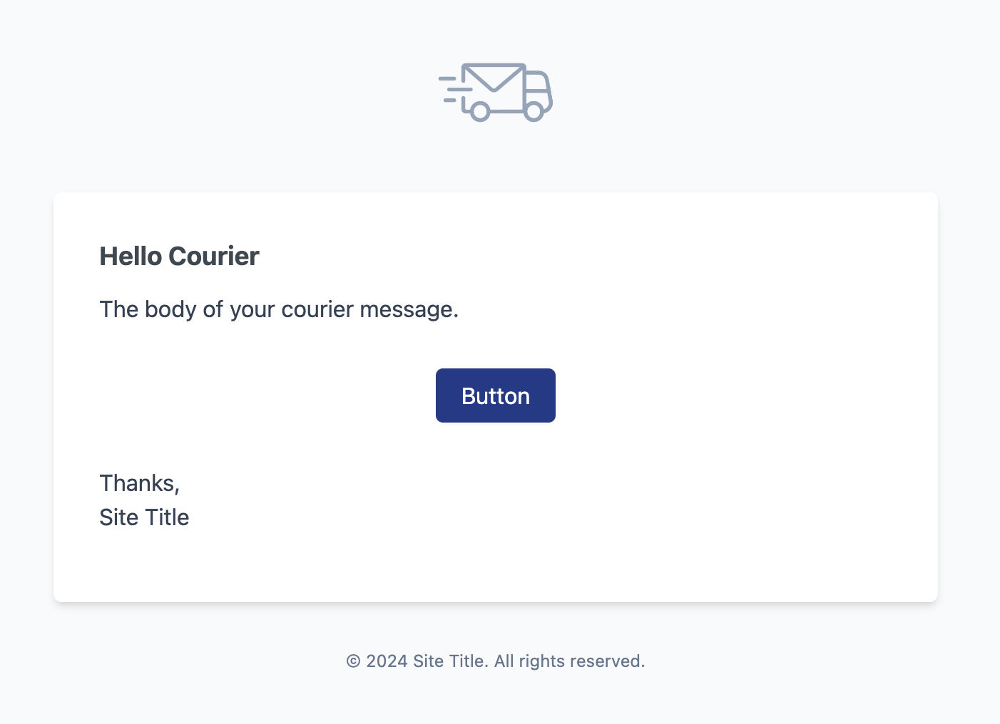

<p align="center"><a href="https://github.com/beebmx/kirby-courier" target="_blank" rel="noopener"></a></p>

<p align="center">
<a href="https://github.com/beebmx/kirby-courier/actions"></a>
<a href="https://packagist.org/packages/beebmx/kirby-courier"></a>
<a href="https://packagist.org/packages/beebmx/kirby-courier"></a>
<a href="https://packagist.org/packages/beebmx/kirby-courier"></a>
</p>

# Courier for Kirby

`Courier` offers a convenient and painless solution for creating emails tailored for your `Kirby` website.
With `Courier`, you can streamline the process of email design and implementation for your site.

****

## Overview

- [1. Compatibility](#compatibility)
- [2. Installation](#installation)
- [3. Usage](#usage)
- [4. Snippets](#snippets)
- [5. Blade](#blade)
- [6. Console](#console)
- [7. Helper](#helper)
- [8. Challenge](#challenge)
- [9. Testing email](#testing-email)
- [10. Escaping](#escaping)
- [11. Options](#options)
- [12. License](#license)
- [13. Credits](#credits)

## Compatibility

| Version       | Kirby 3 | Kirby 4 | Kirby 5 | Kirby 6 | PHP  |
|---------------|:-------:|:-------:|:-------:|:-------:|------|
| 2.x           |    ❌    |    ❌    |    ❌    |    ✅    | 8.4+ |
| 1.3 – 1.5     |    ❌    |    ❌    |    ✅    |    ❌    | 8.3+ |
| 1.1 – 1.2     |    ❌    |    ❌    |    ✅    |    ❌    | 8.2+ |
| 1.0.4 – 1.0.6 |    ❌    |    ✅    |    ✅    |    ❌    | 8.2+ |
| 1.0.0 – 1.0.3 |    ❌    |    ✅    |    ❌    |    ❌    | 8.2+ |

> [!NOTE]
> `Courier` 2.x is built for the Vue 3 Panel of Kirby 6 and is tested on PHP 8.4, 8.5 and 8.6.
> If your site runs Kirby 4 or 5, use `Courier` 1.x.

## Installation

### Download

Download and copy this repository to `/site/plugins/kirby-courier`.

### Composer

```
composer require beebmx/kirby-courier
```

## Usage

`Courier` comes with two email `message` types, and you can customize them for your convenience.



### Notification message

The `Notification` message is the easiest way to send an email. You only need to use the `Beebmx\KirbyCourier\Notification\Message` class
in your `controller` or in your own implementation. Here's an example:

```php
use Beebmx\KirbyCourier\Notification\Message;

(new Message)
    ->to('john@doe.co')
    ->line('Welcome to Kirby Courier')
    ->action('Visit', 'https://beeb.mx')
    ->send()
```

#### Formating notification messages

You have several methods to customize your `Notification` message.
Here's an example with all the methods:

```php
use Beebmx\KirbyCourier\Notification\Message;

(new Message)
    ->to('john@doe.co')
    ->greeting('Hello friend!')
    ->line('Welcome to Kirby Courier')
    ->line('You can add more lines before an action')
    ->lines(['Multiple line 01', 'Multiple line 02'])
    ->lineIf($someCondition === true, 'You can add more lines before an action')
    ->linesIf($someCondition === false, ['Line 03', 'Line 04'])
    ->success()         // To set the action button as successful
    ->error()           // To set the action button as an error
    ->action('Action button', 'https://beeb.mx')
    ->line('You can add lines after an action')
    ->salutation('Good bye!')
    ->send()
```

> [!WARNING]
> You can only add one `action` per `Notification` message.

### Mail message

The `Mail` message is the easiest way to send an email if you need to customize all the body of your email, you only need to use the `Beebmx\KirbyCourier\Mail\Message` class
in your `controller` or in your own implementation. Here's an example:

```php
use Beebmx\KirbyCourier\Mail\Message;

(new Message)
    ->to('john@doe.co')
    ->template('marketing')
    ->send()
```

> [!NOTE]
> It's important that you set a `template` to display your own customization.
> Every template should be located in your `courier` directory.

#### Formating mail messages

To create your own `template` for your `mail` messages, you need to create a file in the default location for `Courier`.
Here's an example for a marketing message:

```php
/*** /site/template/courier/marketing.php ***/

<?php snippet('courier/message', slots: true) ?>
<?php slot('body') ?>
# Hello Courier

The body of your courier message.

<?php snippet('courier/button', ['url' => ''], slots: true) ?>
Button
<?php endsnippet() ?>

Thanks,
<?= site()->title() ?>
<?php endslot() ?>
<?php endsnippet() ?>
```

> [!NOTE]
> You can add content as `markdown` and it will be processed by `kirbytext`.

### Message methods

For both [Notifications](#notification-message) and [Mail](#mail-message) messages, there are shared methods.
Here's an example with all the methods:

```php
use Beebmx\KirbyCourier\Mail\Message;

(new Message)
    ->preset('contact')                     // The preset should be available in your config.php file
    ->from('no-reply@example.co')
    ->from('no-reply@example.co', 'Webmaster')  // You can add a name to from address
    ->to('john@doe.co')
    ->to('jane@doe.co')                     // You can add multiple recipients (TO)
    ->cc('john@doe.co')
    ->cc('jane@doe.co')                     // You can add multiple recipients (CC)
    ->bcc('john@doe.co')
    ->bcc('jane@doe.co')                    // You can add multiple recipients (BCC)
    ->replyTo('john@doe.co')
    ->subject('Thank you for your contact request')
    ->theme('dark')                         // The theme should be available in your themes
    ->data(['name' => 'John Doe', 'position' => 'CEO']) // All the data available for the template
    ->attach($page->file('image.jpg'))
    ->attach($page->file('file.pdf'))       // You can add multiple files
    ->attachMany([$page->file('file.pdf'), $page->file('file.jpg')])
    ->render()                              // Returns a Content instance to visualize
    ->send()                                // Trigger to send the email
```

If you want to previsualize your email, you can do it in any template. Here's an example:

```php
<?= (new Beebmx\KirbyCourier\Mail\Message)
    ->template('marketing')
    ->data(['name' => 'John Doe'])
    ->render()
    ->toHtml() ?>
```

> [!NOTE]
> The `render` method doesn't trigger any email, and doesn't require any email settings
> like `subject`, `from` or `to`.

## Snippets

For your convenience, `Courier` has some `snippets` to speed up your email building flow.
You can add them in your `courier template`.

> [!NOTE]
> You can create your own `snippets` if you want and apply it to the `courier/message` snippet.
> Just be sure to add it in the `slot('body')`.

### Button

```php
<?php snippet('courier/button', ['url' => ''], slots: true) ?>
Button
<?php endsnippet() ?>
```

### Panel

```php
<?php snippet('courier/panel', slots: true) ?>
This is a panel
<?php endsnippet() ?>
```

### Table

```php
<?php snippet('courier/table', slots: true) ?>
| Content      | Info          | Currency  |
| ------------ | :-----------: | --------: |
| Content 01   | Centered      | $100      |
| Content 02   | Is centered   | $150      |
<?php endsnippet() ?>
```

### Subcopy

```php
<?php snippet('courier/subcopy', slots: true) ?>
This is a subcopy
<?php endsnippet() ?>
```

## Blade

If you prefer [Blade](https://laravel.com/docs/blade) over plain PHP templates, `Courier` works out of the box
with [Kirby Blade](https://github.com/beebmx/kirby-blade) `^7.0`:

```
composer require beebmx/kirby-blade
```

When `Kirby Blade` is installed, `Courier` uses its Blade templates for the default `mail` and `notification` messages,
and every snippet is available as an anonymous component with the `courier` prefix:

```blade
{{-- /site/templates/courier/marketing.blade.php --}}

<x-courier::message :logo="$logo">
# Hello {{ $name }}

The body of your courier message.

<x-courier::button url="https://beeb.mx" color="success">
Button
</x-courier::button>

<x-courier::panel>
This is a panel
</x-courier::panel>

Thanks,
{{ site()->title() }}
</x-courier::message>
```

The available components are `message`, `layout`, `header`, `footer`, `button`, `code`, `panel`, `subcopy` and `table`.
They are rendered as HTML for the email body and as plain text for its text version.

> [!NOTE]
> Every template is rendered with the elements that match it: `*.blade.php` templates use the Blade components and
> `*.php` templates use the snippets, so you can mix both kinds of templates in the same site.

If `Kirby Blade` is installed but you want to keep the PHP templates as the default `Courier` templates,
disable its bootstrap in your `config.php` file:

```php
'beebmx.kirby-blade.bootstrap' => false,
```

> [!WARNING]
> `Kirby Blade` requires to disable the Kirby `e()` helper. Please follow the
> [Kirby Blade installation notes](https://github.com/beebmx/kirby-blade#conflicts).

> [!NOTE]
> On PHP 8.6, `Kirby Blade` needs `illuminate/view` `^13.0`. Version 12 raises `spl_object_hash()` deprecations
> that break the rendering, so update it with `composer require illuminate/view:^13.0` if needed.

## Console

If you are a [Kirby CLI](https://github.com/getkirby/cli) user, `Courier` also has you covered.
The `Courier` commands can help you create `Mail` messages faster or even create your own `Courier Theme`.

You can create your `Mail` template with:

```shell
$ kirby make:courier <template>
$ kirby courier:make <template>
```

> [!NOTE]
> `courier:make` is an alias of `make:courier`

To create a `Blade` template, add the `--blade` flag:

```shell
$ kirby make:courier <template> --blade
```

Or may be you want to customize your messages with your own `theme` with:

```shell
$ kirby courier:theme <theme>
```

## Helper

If dealing with `namespaces` is hard, or you feel confused using the same `Message` class name,
you can simplify it with the `courier` helper:

For `Notification` message you can use:

```php
courier('notification')
    ->to('john@doe.co')
    ->line('This is a line')
    ->send()
```

For `Mail` message you can use:

```php
courier('mail')
    ->to('john@doe.co')
    ->template('marketing')
    ->send()
```

And of course, you can use it in a `template` to render it:

```php
<?= courier('mail')
        ->template('marketing')
        ->render()
        ->toHtml() ?>
```

## Challenge

`Courier` also provides a `challenge` message type to help you with your login and password reset flows.
The `courier` challenge works like the Kirby `email` challenge, but the code is sent with a `Courier` notification message.

First, you need to set the `challenge` in your `config.php` file:

```php
'auth' => [
    'challenges' => ['courier', 'email'],
],
```

> [!NOTE]
> Kirby 6 enables the `webauthn`, `totp` and `email` challenges by default. When you set the `challenges` option,
> add the ones you want to keep, for example: `['webauthn', 'totp', 'courier']`.

Then, you can specify the `methods` you want to use in your `config.php` file:

```php
'auth' => [
    'challenges' => ['courier', 'email'],
    'methods'   => ['password', 'code'],
],
```

> [!WARNING]
> The `courier` challenge sends the codes for the `code` and `password-reset` methods, and for the two-factor authentication.


## Testing email

`Courier` comes out of the box with a panel `area` to help you test your email messages. You can change the `label` and `icon` from the `config.php` file.
```php
'beebmx.courier' => [
    'panel' => [
        'label' => 'Testing',
        'icon' => 'wand',
    ],
],
```

> [!NOTE]
> If you change the `icon`, be sure to use an available `Kirby Panel` icon from the [official list](https://getkirby.com/docs/reference/panel/icons).

If you only want to enable the `testing area` for specific user roles, you can do it with the `roles` option:

```yaml
#bluprints/users/editor.yml

permissions:
  access:
    courier: false
```

If this option is not for you or all your users, you can disable it completely with:

```php
'beebmx.courier' => [
    'panel' => false
],
```

> [!NOTE]
> The same rules protect the API route that sends the test email: it only works for logged-in users
> with access to the `courier` area, and it's disabled together with the `panel` option.

## Escaping

The values of the `Notification` message (`greeting`, `line`, `code`, `action` and `salutation`) are escaped,
so it's safe to add user input like a contact form message. `Markdown` keeps working, but `HTML` is shown as text.

If you need `HTML` in your message, create a `Mail` message with your own template.

## Options

| Option                                               |           Type            |       Default        | Description                                                |
|:-----------------------------------------------------|:-------------------------:|:--------------------:|:-----------------------------------------------------------|
| beebmx.courier.logo                                  | `Closure`,`string`,`null` |         null         | Set your own logo in every message.                        |
| beebmx.courier.path                                  |         `string`          |       courier        | Set a path where the `templates` and `themes` are located. |
| beebmx.courier.from.address                          |           `int`           |          4           | Set the default `form.address` for every message.          |
| beebmx.courier.from.name                             |           `int`           |          2           | Set the default `form.name` for every message.             |
| beebmx.courier.message.greeting                      |         `string`          |        Hello!        | Set the default `message.greeting` for every message.      |
| beebmx.courier.message.rights                        |         `string`          | All rights reserved. | Set the default `message.rights` for every message.        |
| beebmx.courier.message.salutation                    |         `string`          |       Regards        | Set the default `message.salutation` for every message.    |
| beebmx.courier.message.subject                       |         `string`          | Message from courier | Set the default `message.subject` for every message.       |
| beebmx.courier.message.notify                        |         `string`          |                      | Set the default `message.notify` for every message.        |
| beebmx.courier.message.brand_name                    |         `?string`         |         null         | Set the default `message.brand_name` for every message.    |
| beebmx.courier.challenge.theme                       |         `?string`         |       default        | Set the default `theme` for your challenge message.        |
| beebmx.courier.challenge.greeting                    |         `?string`         |         null         | Set the `greeting` message for your challenge.             |
| beebmx.courier.challenge.email.login.before          |         `?string`         |         null         | Set the text before `code` for login message.              |
| beebmx.courier.challenge.email.login.after           |         `?string`         |         null         | Set the text after `code` for login message.               |
| beebmx.courier.challenge.email.password-reset.before |         `?string`         |         null         | Set the text before `code` for password-reset message.     |
| beebmx.courier.challenge.email.password-reset.after  |         `?string`         |         null         | Set the text after `code` for password-reset message.      |
| beebmx.courier.panel.label                           |         `string`          |       Courier        | Set a path where the `templates` and `themes` are located. |
| beebmx.courier.panel.icon                            |         `string`          |        email         | Set a path where the `templates` and `themes` are located. |

Here's an example of a full use of the options from the `config.php` file:

```php
'beebmx.courier' => [
    'logo' => function() {
        return site()->file('logo.png'); // or an asset, a URL or a files field: site()->logo()
    },
    'path' => 'courier',
    'from' => [
        'address' => 'hello@example.com',
        'name' => 'Example',
    ],
    'message' => [
        'greeting' => 'Hello friend!',
        'rights' => 'Copyrights.',
        'salutation' => 'Thanks',
        'subject' => 'Message from courier',
        'notify' => 'If you’re having trouble clicking the button, copy and paste the URL below into your web browser.',
        'brand_name' => null,
    ],
    'challenge' => [
        'theme' => 'your-own-theme',
        'greeting' => 'Hello friend!',
        'email' => [
            'login' => [
                'before' => 'Recently, a login attempt was made on your account. You have X minutes to complete the login.',
                'after' => 'DO NOT share this code with anyone. If you did not request this login, you can ignore this email.',
            ],
            'password-reset' => [
                'before' => 'Recently, a login attempt was made on your account. You have X minutes to complete the login.',
                'after' => 'DO NOT share this code with anyone. If you did not request this password reset, you can ignore this email.',
            ],
        ],
    ],
    'panel' => [
        'label' => 'Courier',
        'icon' => 'email',
    ],
],
```

> [!WARNING]
> Since version `1.2.0`, `Courier` changes the plugin prefix from `beebmx.kirby-courier` to `beebmx.courier`.

## License

Licensed under the [MIT](LICENSE.md).

## Credits

`Courier` is inspired by the [Laravel Notifications](https://laravel.com/docs/master/notifications) and [Laravel Mail](https://laravel.com/docs/master/mail).

- Fernando Gutierrez [@beebmx](https://github.com/beebmx)
- Jonas Ceja [@jonatanjonas](https://github.com/jonatanjonas) `logo`
- [All Contributors](../../contributors)
